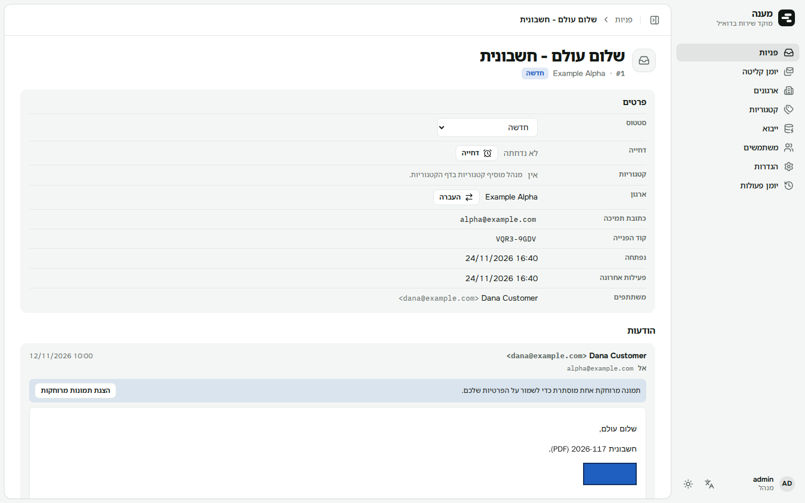

# Maane

A self-hosted helpdesk for email only, with correct Hebrew and right-to-left text in the agent UI and in the email customers receive.

Maane answers customer email for several organizations from one place. Mail reaches one Microsoft 365 shared mailbox through transport rules and is read through Microsoft Graph; replies go out through SMTP2GO with a plain SMTP failover. Agents work in a web UI in Hebrew or English, and every reply reaches the customer laid out correctly in both directions. It replaces a Zendesk account and imports all of its history.

Not released yet: the first version is being prepared.

## Main features

- Tickets from email, threaded and matched to the right organization by its support addresses, including wildcard patterns.
- Replies laid out per paragraph in the right direction, with the conversation's history, sent with delivery status and bounce tracking.
- Scheduled replies, snooze, statuses, categories, search, and an automatic reminder while a ticket waits for the customer.
- Every file scanned by ClamAV, with a policy for when the scanner cannot answer, and previews in the browser.
- Tracked links and download links in customer email.
- Sign-in with mandatory two-factor authentication, agents scoped to their organizations, and an audit log.
- Browser notifications, as an installable web app.
- An import of the full Zendesk history from a backup archive.

## Installation

Requirements: a Docker host with Traefik on an external network named `traefik`, with an HTTPS entry point `https` and a middleware chain `default@file` (other names: change the labels and the network in `docker-compose.yml`), serving Maane's host names with a valid certificate, a Microsoft 365 shared mailbox with an Entra application that may read it, and an SMTP2GO account (plus a second SMTP server for the failover).

1. In a new folder on the host, put the release's `docker-compose.yml` and `docker/clamav/`. Copy `.env.example`, `docker/env/postgres.env.example`, and `docker/env/app.env.example` there as `.env`, `postgres.env`, and `app.env`, readable by you only.
2. Fill them in as their own notes say: the version and the host names, one random database password, two random keys (`openssl rand -hex 32` for each), and the subnets of the Traefik network. Replace the two empty browser notification keys with the lines that `docker run --rm --entrypoint node ghcr.io/shlomiporush/maane:<version> dist/worker/vapid-keys.js` prints once.
3. Create the folder `data`, owned by UID 1000, and the folder `clamav`, owned by UID 100.
4. Run `docker compose up -d`, open Maane's address, and create the first admin on the setup screen within five minutes.

To update, take a backup, set the new `VERSION` in `.env`, and run `docker compose pull && docker compose up -d`. To uninstall, take a final backup, run `docker compose down`, and remove the folder.

## Common questions

- **Can Maane use a ClamAV server I already run?** Yes. Set its address in Settings, Files and scanning.
- **Does the import call Zendesk?** No. The Zendesk backup tool writes an archive, and the import reads only that archive.
- **Where do settings live?** In the admin UI. An environment variable can set and lock a field; the UI then shows which variable sets it.

## Documents

- [Deployment](docs/deployment.md)
- [Zendesk backup](docs/zendesk-backup.md)
- [Product requirements](docs/requirements.md)
- [Foundation plan, decisions, and status](docs/project-foundation.md)
- [Changelog](CHANGELOG.md)
- [Agent instructions](AGENTS.md)

Stack

TypeScript on Node.js, pnpm workspaces. Server: Hono, Better Auth, Drizzle ORM on PostgreSQL. Worker: pg-boss, the Microsoft Graph SDK, mailparser, Nodemailer, web-push. Web: React, React Router, TanStack Query, Tiptap, Vite. ClamAV, MaxMind GeoLite2, Docker Compose behind Traefik. Tests: Vitest and Playwright.

## License

MIT. See [LICENSE](LICENSE).
